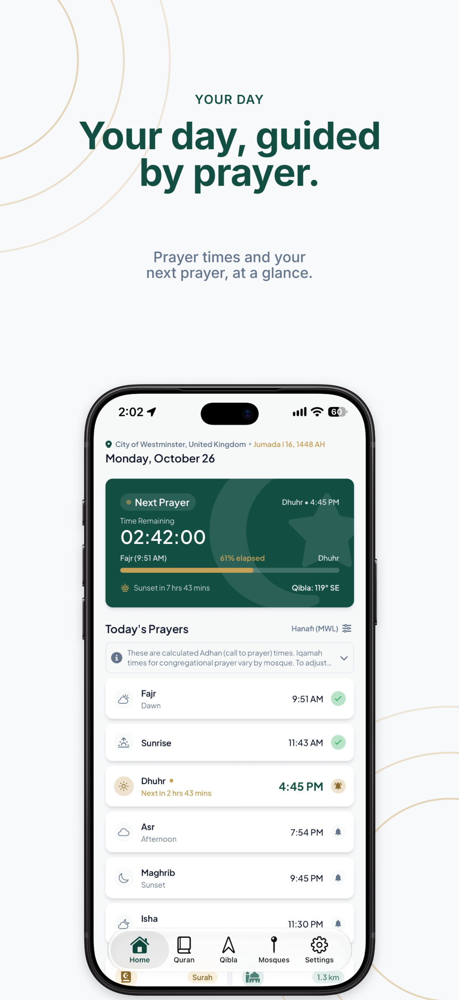
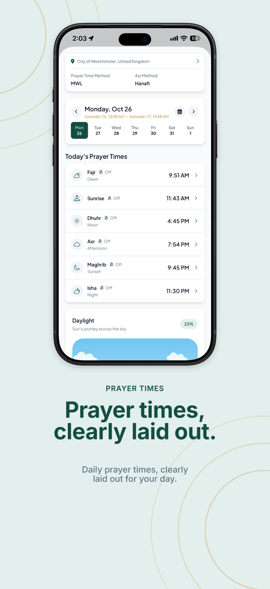
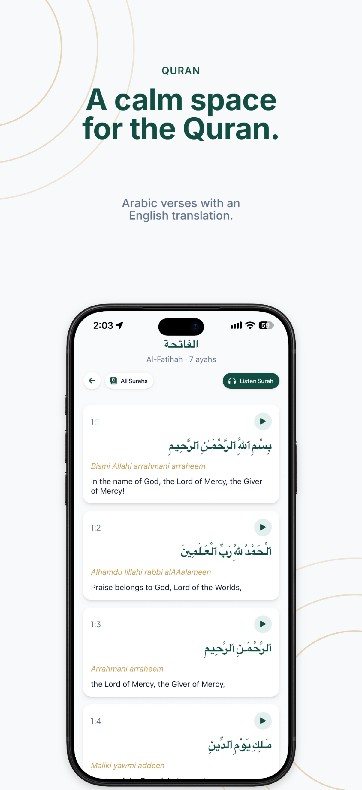
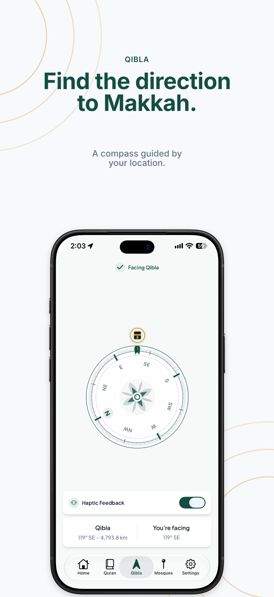
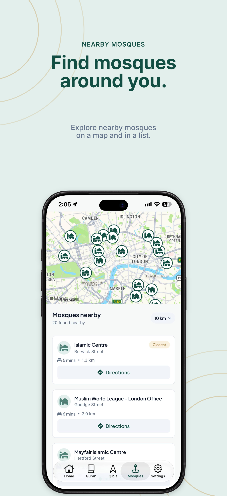
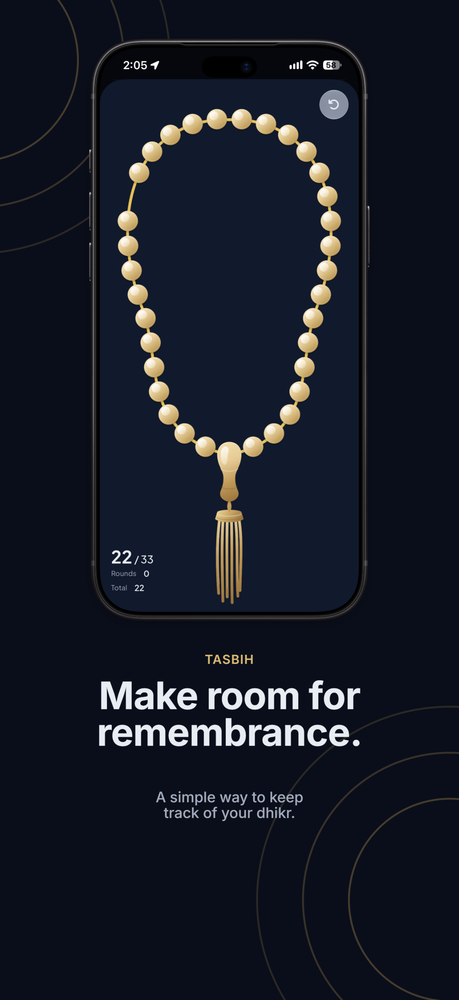
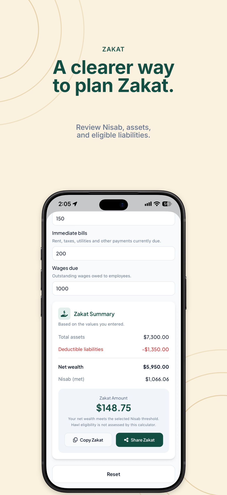
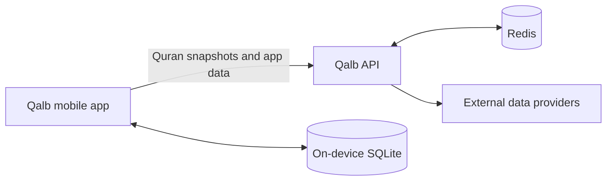

# Qalb

**A thoughtful companion for the rhythms of everyday Muslim life.**

Qalb brings prayer, Quran, remembrance, and practical tools together in one
English and Russian app for iOS and Android.

<p align="center">
  
  
  
  
  
  
  
</p>

## What’s inside

| Worship | Everyday tools |
| --- | --- |
| Prayer times, reminders, and calculation settings | Nearby mosques, maps, and route estimates |
| Quran reading, search, translations, and recitation | Zakat calculator with live gold and silver prices |
| Qibla compass | Tasbih and spiritual-pause counters |

Quran content is stored on the device after its first download, so reading and
search remain available offline. Network-backed features use the Qalb API, and
the app keeps provider credentials on the server.

## How the pieces fit



The mobile app handles the interface, local Quran storage, device location,
prayer calculations, compass sensors, and reminders. The API coordinates
Quran-content sync and provider-backed data. `packages/shared` holds types
used by both workspaces.

## Run locally

You’ll need Node.js 22.13 or newer and Yarn Classic (1.x). From the repository
root, install dependencies and prepare the two local environment files:

```sh
yarn install --frozen-lockfile
```

Copy `apps/api/.env.example` to `apps/api/.env.local` and configure Redis and
any provider credentials you need. Copy `apps/mobile/.env.example` to
`apps/mobile/.env.local` and set `EXPO_PUBLIC_API_URL` to the API origin. For a
physical phone, use an address reachable on your Wi-Fi network instead of
`localhost`.

Start the API and app in separate terminals from the repository root:

```sh
yarn workspace api start:dev
yarn workspace qalb start
```

Android native builds also need a Google Maps API key. See the workspace
guides for device setup, environment details, and commands:

- [Mobile app guide](apps/mobile/README.md)
- [API guide](apps/api/README.md)

## Repository map

| Path | Purpose |
| --- | --- |
| `apps/mobile` | Expo app for iOS, Android, and web |
| `apps/api` | NestJS API and Quran content synchronization |
| `packages/shared` | Types shared between the mobile app and API |
| `docs/legal` | Privacy policy and terms of use |
| `legal-site` | Static site that publishes the legal documents |

## Project checks

Run the mobile and API checks from the repository root:

```sh
yarn workspace qalb lint
yarn workspace qalb tsc --noEmit
yarn workspace qalb test
yarn workspace api lint
yarn workspace api test
yarn workspace api test:e2e
yarn workspace api build
```
