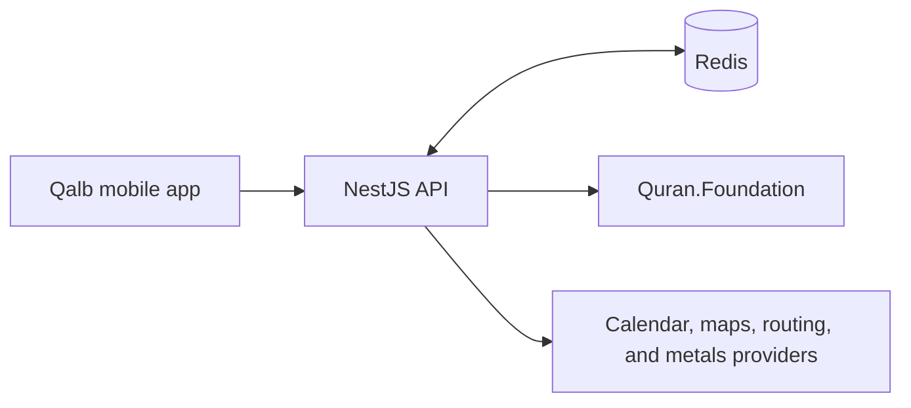

# Qalb API

The Qalb API is a NestJS service used by the mobile app for Quran content
updates and network-backed features. It connects the app to external data
providers while keeping provider credentials on the server.

## Responsibilities

- Synchronize Quran.Foundation content and serve versioned snapshots and
  changes to the mobile app.
- Find nearby mosques and return route estimates.
- Reverse-geocode coordinates into a place name.
- Provide Islamic calendar events and current gold and silver prices.
- Cache provider responses and persist Quran sync data in Redis.



## Run locally

Use Node.js 22.13 or newer and Yarn Classic (1.x). Install dependencies from
the repository root:

```sh
yarn install --frozen-lockfile
```

Copy `apps/api/.env.example` to `apps/api/.env.local`. Set `REDIS_URL` to a
Redis instance reachable by the API. Add credentials for integrations you want
to use. Start the development server from the repository root:

```sh
yarn workspace api start:dev
```

The default local API origin is `http://localhost:3000`. Set the mobile app's
`EXPO_PUBLIC_API_URL` to this origin, or to an address reachable from your
device when testing on a physical phone. See the [mobile app guide](../mobile/README.md).

## Configuration

The checked-in `.env.example` lists defaults and all supported variables. Keep
real credentials in the untracked `.env.local` file or deployment environment.

| Variables | Used for |
| --- | --- |
| `PORT`, `LOG_LEVEL` | HTTP port and log verbosity |
| `REDIS_URL` | Quran sync storage, cache, and shared rate limiting |
| `QURAN_FOUNDATION_ENV` | Quran.Foundation environment |
| `QURAN_FOUNDATION_CLIENT_ID`, `QURAN_FOUNDATION_CLIENT_SECRET` | Quran.Foundation credentials |
| `QURAN_SYNC_TIMEZONE`, `QURAN_SYNC_HOUR` | Weekly Quran sync schedule |
| `METALS_API_KEY`, `METALS_API_URL` | Gold and silver price provider |
| `ALADHAN_API_URL` | Islamic calendar provider |
| `MOSQUES_API_URL` | Nearby mosque provider |
| `NOMINATIM_API_URL` | Reverse geocoding provider |
| `ROUTING_API_URL` | Route estimates |

Quran synchronization requires Redis and valid Quran.Foundation credentials.
Other integrations can use their configured public endpoints; add provider
credentials in the API environment where required. Never put API secrets in
mobile `EXPO_PUBLIC_*` variables.

## HTTP endpoints

| Method | Path | Purpose |
| --- | --- | --- |
| `GET` | `/api/quran/status` | Quran content availability and sync status |
| `GET` | `/api/quran/snapshot` | Current Quran content snapshot |
| `GET` | `/api/quran/changes` | Changes since a client revision |
| `GET` | `/api/mosques/nearby` | Nearby mosque results |
| `GET` | `/api/reverse-geocoding` | Place name for coordinates |
| `POST` | `/api/routing/route` | Route estimate |
| `POST` | `/api/routing/metrics` | Route metrics |
| `GET` | `/api/islamic-events/calendar` | Islamic calendar events |
| `GET` | `/api/metals/latest` | Latest gold and silver prices |

## Checks and builds

Run from the repository root:

```sh
yarn workspace api lint
yarn workspace api test
yarn workspace api test:e2e
yarn workspace api build
yarn tsc --noEmit -p apps/api/tsconfig.json
```

The API uses Oxlint and Vitest. Unit tests are in `src/`; HTTP end-to-end tests
are in `test/`.
\n