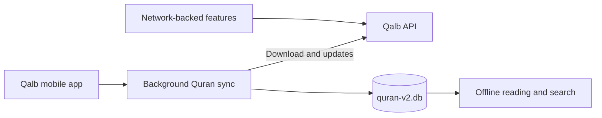

# Qalb mobile app

Qalb is an Expo app for iOS and Android, with a web build for development and
supported deployments. It brings Quran reading, prayer times, Qibla, nearby
mosques, remembrance, and zakat tools into one English and Russian interface.

Web hosting must send `Cross-Origin-Embedder-Policy: credentialless` and
`Cross-Origin-Opener-Policy: same-origin` headers for `expo-sqlite` to use
`SharedArrayBuffer`. On EAS Hosting, configure these headers under the
`expo-router` plugin in the app config.

## Features

- **Prayer times:** daily schedules, calculation preferences, adjustments, and
  local reminders.
- **Quran:** Arabic text, transliteration, translations, search, and audio
  recitation.
- **Qibla:** compass direction to Makkah using the device location and sensors.
- **Mosques:** nearby locations, map results, and route estimates.
- **Remembrance:** a tasbih counter and spiritual-pause counters.
- **Zakat:** a USD calculator with gold and silver market prices.

The Quran is downloaded to a local SQLite database and can be read and searched
offline after setup. Quran updates and other API-backed features need a network
connection.

## Run the app

The app uses Expo SDK 58. Use Node.js 22.13 or newer and Yarn Classic (1.x).
Install dependencies from the repository root:

```sh
yarn install --frozen-lockfile
```

Copy `apps/mobile/.env.example` to `apps/mobile/.env.local` and set
`EXPO_PUBLIC_API_URL` to the Qalb API origin. When the API runs on your
development computer, use `localhost` for the iOS Simulator, `10.0.2.2` for
the Android Emulator, and a LAN-reachable address for physical devices.
Production builds should use an HTTPS API URL configured in the EAS environment.

Start the API in one terminal if you are running it locally:

```sh
yarn workspace api start:dev
```

Then start the mobile app from another terminal:

```sh
yarn workspace qalb start
```

Expo will show options for opening the app in a simulator or on a device. The
workspace also provides these commands from the repository root:

```sh
yarn workspace qalb start --clear
yarn workspace qalb ios
yarn workspace qalb android
yarn workspace qalb web
```

Android native builds use `GOOGLE_MAPS_API_KEY` for map tiles. Expo Go is useful
for supported development flows; use a development build to verify native
notifications, background work, maps, and release behavior.

## Quran data flow



On first launch, the app prepares its local database and fetches Quran content
in the background. If the network is unavailable, previously downloaded Quran
content remains available. The app checks for updates periodically.

## Development checks

Run these commands from the repository root:

```sh
yarn workspace qalb lint
yarn workspace qalb tsc --noEmit
yarn workspace qalb i18n:check
yarn workspace qalb test
yarn workspace qalb test:coverage
```

Run Expo Doctor from `apps/mobile`:

```sh
npx expo-doctor
```

Mobile tests use Jest with `jest-expo`. They cover API helpers, Quran
bootstrap and sync, location and compass behavior, and calculation edge cases.

## Code map

| Path             | Purpose                                      |
| ---------------- | -------------------------------------------- |
| `src/app`        | Routes and navigation                        |
| `src/components` | Screen and shared UI components              |
| `src/hooks`      | Device and feature behavior                  |
| `src/lib`        | Calculations, API clients, and Quran storage |
| `src/store`      | User and app state                           |
| `src/i18n`       | English and Russian translations             |
| `assets`         | Fonts, icons, and other app assets           |
